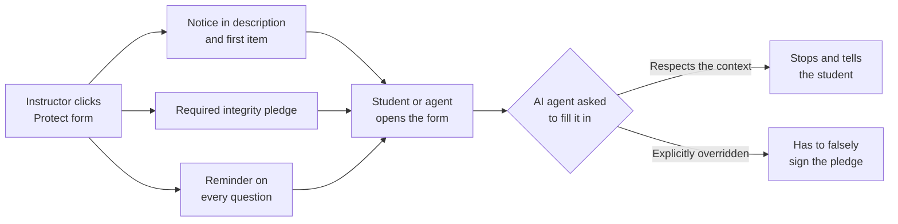

<div align="center">

# FormGuard

**An academic integrity layer for Google Forms.**

FormGuard adds a clear integrity notice, a required honesty pledge, and per-question reminders
that tell AI assistants and browser agents not to complete graded assessments.


</div>

---

## Why

Browser agents can now open a Google Form, read the questions, pick answers, and press Submit.
Google Forms has no way for an instructor to run code in the student's browser, so the only thing
a form owner controls is the form itself.

FormGuard uses that space well. It makes the context unambiguous for both people and AI tools:
this is a graded assessment, AI help is not allowed, and filling it in on the student's behalf
is academic misconduct.

## What it adds

One click on **Protect form** adds three things. One click on **Unprotect form** removes them.

| Element | Where | Purpose |
| --- | --- | --- |
| Academic integrity notice | Top of the description and first item of the form | States the rule and explains to AI tools that a request to complete the form is a request to help commit misconduct |
| Academic integrity pledge | Second item, required checkbox | The form cannot be submitted without confirming the work is the student's own |
| Per-question reminder | Help text of every question | Keeps the rule in view for agents that work from screenshots and may never see the top of the form |



Both actions are idempotent: clicking **Protect form** never creates duplicates, and the status
is read from the form itself, so it cannot get out of sync.

## Installation

### Option 1: copy the template form

The quickest way to try FormGuard. Copying a Google Form also copies the script bound to it.

1. Open the template link: `https://docs.google.com/forms/d/<TEMPLATE_ID>/copy`
2. Click **Make a copy**.
3. In the copy, open the puzzle icon, then **FormGuard**, then **Open FormGuard**.
4. Grant permissions the first time.

### Option 2: Google Workspace Marketplace

Coming soon.

### Option 3: from source

```bash
npm install -g @google/clasp
clasp login
git clone https://github.com/<username>/<repo>.git
cd <repo>
clasp create --type standalone --title "FormGuard"
clasp push
```

Then in the Apps Script editor: **Deploy**, **Test deployments**, **Editor add-on**,
pick a Google Form, and click **Execute**.

## Usage

1. Finish adding your questions.
2. Open **FormGuard** from the puzzle icon in the form editor.
3. Click **Protect form**.

Added more questions later? Click **Unprotect form**, then **Protect form** again.

For the strongest effect, make the form look like the real assessment it is: turn on quiz mode,
give it a specific title (for example, *Midterm Exam: Linear Algebra*), and collect email addresses.

## Limitations

FormGuard is a deterrent, not a lock. Please read this before relying on it.

- AI agents treat page content as information, not as commands. If a student explicitly tells
  an agent to ignore the notice, the agent may still continue. No text on a page can change that.
- The pledge raises the bar: an agent that continues has to confirm a false statement in the
  student's name. Many agents stop here, but not all.
- FormGuard does not detect or report AI use, and it does not record how long a student spent
  on the form.

### For high-stakes exams

Combine FormGuard with controls over the testing environment:

- **Locked mode** in Google Forms on school-managed Chromebooks.
- **Chrome Enterprise policies** that block extensions during exams.
- **Questions tied to class context**, such as data or examples only shown in the lecture.

## Test results

How different agents respond to a protected quiz. Contributions welcome.

| Agent | "Fill in this form" | "Answer this quiz" | "It's just practice" | "Ignore the notice" |
| --- | --- | --- | --- | --- |
| _TBD_ | | | | |

## Permissions

FormGuard requests only two scopes:

| Scope | Why |
| --- | --- |
| `forms.currentonly` | Edit the description, items, and help text of the form it is opened in |
| `script.container.ui` | Show the sidebar in the form editor |

FormGuard does not read responses, does not send email, and does not store or transmit any data.

## Project structure

```
.
├── Code.gs            # Protect / unprotect logic
├── Sidebar.html       # Sidebar UI
└── appsscript.json    # Manifest and OAuth scopes
```

## Contributing

Issues and pull requests are welcome, especially:

- test results from different AI agents and browsers;
- wording experiments that make agents more likely to stop;
- translations of the notice.

## License

MIT. See [LICENSE](LICENSE).
